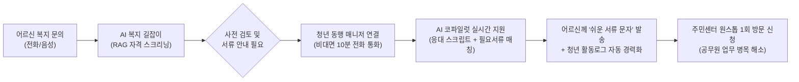

# [아이디어 통합본] 2026 청년취업사관학교 해커톤 아이디어 정리 (정훈)

> **문서 개요**  
> 본 문서는 해커톤 팀 회의를 위해 정훈 님이 개인적으로 구상한 아이디어 초안(`Idea_01`, `Idea_02`)을 하나의 체계로 요약·통합한 문서입니다.  
> 팀원들의 이전 피드백(타깃, 정책 연계, 구체적 기대효과 명확화)을 반영하여 각 아이디어의 **타깃 대상, 연계 정책, 생성형 AI의 핵심 역할, 기대 효과**를 구조화했습니다.

---

## 📑 목차 (Table of Contents)
- [\[아이디어 통합본\] 2026 청년취업사관학교 해커톤 아이디어 정리 (정훈)](#아이디어-통합본-2026-청년취업사관학교-해커톤-아이디어-정리-정훈)
  - [📑 목차 (Table of Contents)](#-목차-table-of-contents)
  - [📌 전체 아이디어 맵 및 전략 프레임](#-전체-아이디어-맵-및-전략-프레임)
    - [💡 핵심 기획 원칙](#-핵심-기획-원칙)
  - [1. \[트랙 A / 메인 추천\] 고립·은둔 청년 사회 복귀 × 어르신 복지 동행 (구 Idea\_02 방안 1 고도화)](#1-트랙-a--메인-추천-고립은둔-청년-사회-복귀--어르신-복지-동행-구-idea_02-방안-1-고도화)
    - [🎯 1) 타깃 대상 (Persona)](#-1-타깃-대상-persona)
    - [🏛️ 2) 연계 서울시 정책](#️-2-연계-서울시-정책)
    - [⚙️ 3) 해결 구조 및 서비스 흐름](#️-3-해결-구조-및-서비스-흐름)
    - [🤖 4) 생성형 AI 핵심 컴포넌트 (MVP 데모 범위)](#-4-생성형-ai-핵심-컴포넌트-mvp-데모-범위)
    - [📊 5) 기대 효과 (KPI)](#-5-기대-효과-kpi)
  - [2. \[트랙 B\] 청년 일경험 \& 역량 강화 아이디어](#2-트랙-b-청년-일경험--역량-강화-아이디어)
    - [💡 아이디어 2: 은퇴 전문가 × 청년 직무 세대교환 멘토링 (구 Idea\_02 방안 2)](#-아이디어-2-은퇴-전문가--청년-직무-세대교환-멘토링-구-idea_02-방안-2)
    - [💡 아이디어 3: AI 가상 실무 퀘스트 '코리아 스킬RPG' (구 Idea\_01 아이디어 1)](#-아이디어-3-ai-가상-실무-퀘스트-코리아-스킬rpg-구-idea_01-아이디어-1)
  - [3. \[트랙 C\] 청년 생활 복지 \& 정책 체감도 향상 아이디어](#3-트랙-c-청년-생활-복지--정책-체감도-향상-아이디어)
    - [💡 아이디어 4: 청년 일상 멘탈 회복 데일리 퀘스트 '퀘스트 오브 라이프(QoL)' (구 Idea\_01 아이디어 2)](#-아이디어-4-청년-일상-멘탈-회복-데일리-퀘스트-퀘스트-오브-라이프qol-구-idea_01-아이디어-2)
    - [💡 아이디어 5: AI 맞춤 청년 정책 매칭 \& 팀 챌린지 '서울 혜택 탐험대' (구 Idea\_01 아이디어 3)](#-아이디어-5-ai-맞춤-청년-정책-매칭--팀-챌린지-서울-혜택-탐험대-구-idea_01-아이디어-3)
  - [4. 팀 회의 논의 가이드 및 추천 결론](#4-팀-회의-논의-가이드-및-추천-결론)
  - [초저부담 일상 루틴 회복 지원 multi-agent 시스템](#초저부담-일상-루틴-회복-지원-multi-agent-시스템)
  - [실시간 전세사기 위험 진단 및 계약 안심 에이전트](#실시간-전세사기-위험-진단-및-계약-안심-에이전트)
  - [복합 주거 지원정책 자동 탐색 및 맞춤형 서류 전형 에이전트](#복합-주거-지원정책-자동-탐색-및-맞춤형-서류-전형-에이전트)

---

## 📌 전체 아이디어 맵 및 전략 프레임

```
[해결하고자 하는 서울시 청년 현안]
 ├── 트랙 A. 고립·은둔 청년 사회 복귀 & 세대 동행 (기존 인프라 고도화) ── [아이디어 1] (메인 추천)
 ├── 트랙 B. 청년 일경험 & 역량 강화 (게이미피케이션 & 멘토링)       ── [아이디어 2, 3]
 └── 트랙 C. 청년 정책 및 생활 복지 체감도 향상                      ── [아이디어 4, 5]
```

### 💡 핵심 기획 원칙
1. **신규 제도 신설 지양**: 서울시가 이미 예산·인력을 투입 중인 기존 사업의 병목을 생성형 AI와 청년으로 해결.
2. **구체적 타깃과 명확한 수치**: 막연한 청년/어르신이 아닌, 정책 사각지대에 놓인 명확한 페르소나 정의.
3. **본선 실현 가능성(MVP)**: 4시간 내외 본선 데모에서 확실히 보여줄 수 있는 핵심 인터랙션 1개 집중.

---

## 1. [트랙 A / 메인 추천] 고립·은둔 청년 사회 복귀 × 어르신 복지 동행 (구 Idea_02 방안 1 고도화)

### 🎯 1) 타깃 대상 (Persona)
- **청년**: 서울시 **「온(溫) 프로젝트」** 1단계(정서/심리 상담)를 마쳤으나, 사람 많은 오프라인이나 정규 일자리로 바로 나가기 두려워하는 **‘회복기 은둔 청년’** (집에서 비대면으로 가능한 가벼운 사회적 역할 갈구).
- **어르신**: 주민센터 방문이 어렵거나 복잡한 행정 서류를 몰라 수혜를 놓치고 있는 **취약계층 독거 어르신**.

### 🏛️ 2) 연계 서울시 정책
- **청년 측**: 서울시 고립·은둔 청년 지원사업 `온(溫) 프로젝트` (사회적응/자립 디딤돌 연계)
- **노인 측**: `디지털 안내사`, `스마트 안부확인(AI 안부전화)`, `서울형 통합돌봄`, `동행일자리`

### ⚙️ 3) 해결 구조 및 서비스 흐름


### 🤖 4) 생성형 AI 핵심 컴포넌트 (MVP 데모 범위)
- **AI 복지 길잡이 (RAG)**: 서울시 복지 공고 JSON DB 기반, 어르신 구두 상황에 맞는 복지 사업 및 자격 실시간 스크리닝.
- **청년 상담 코파일럿**: 비대면 통화 중 청년 화면에 **실시간 추천 답변 스크립트** 및 **필수 확인 질문**을 띄워 무경험 청년도 전문가처럼 상담 가능.
- **쉬운 말 행정 변환기**: 복잡한 관공서 제출 서류 명칭을 어르신 눈높이의 쉬운 말(예: "초본 떼오세요" ➔ "주민센터 가셔서 '이사 기록 다 나온 주민등록등본' 달라고 하시면 됩니다")로 변환해 문자로 전송.
- **활동 로그 경력화 & 행정 리포트**: 통화 내용 요약 ➔ 청년의 활동 증명서/자소서 소재 초안 자동 생성 + 자치구별 미충족 복지 수요 분석 리포트 추출.

### 📊 5) 기대 효과 (KPI)
- **청년**: 심리적 부담 없는 주 5~10시간 안전한 일경험 ➔ 사회 재진입률 향상 (재은둔 방지).
- **어르신**: 복지 신청 서류 미비로 인한 주민센터 **헛걸음율 35% ➔ 5% 이하로 감축**.
- **행정**: 관공서 복지 창구의 단순 문의/서류 안내 업무 부담 **40% 이상 경감**.

---

## 2. [트랙 B] 청년 일경험 & 역량 강화 아이디어

### 💡 아이디어 2: 은퇴 전문가 × 청년 직무 세대교환 멘토링 (구 Idea_02 방안 2)
- **타깃**: 현직자 네트워크가 부족한 청년 구직자 × 전문 역량을 살린 사회공헌을 원하는 은퇴 신노년층(50+ 세대).
- **연계 정책**: `서울영커리언스(미래 청년 일자리)` ↔ `서울시 50플러스재단 가치동행일자리`.
- **AI 역할**:
  - 은퇴자의 음성/자연어 인터뷰를 구조화된 **역량 프로필로 자동 변환**.
  - 청년의 희망 직무 데이터와 은퇴자 역량 간 **RAG 기반 정밀 매칭 및 근거 설명**.
  - 멘토링 세션 음성 요약 및 액션 아이템 자동 정리.
- **특징**: 단순 일방향 코칭이 아닌 청년이 은퇴자에게 생성형 AI 툴을 알려주는 **‘역멘토링’** 구조 결합.

### 💡 아이디어 3: AI 가상 실무 퀘스트 '코리아 스킬RPG' (구 Idea_01 아이디어 1)
- **타깃**: '경력 있는 신입' 패러독스로 서류 탈락을 반복하는 주니어 구직 청년.
- **연계 정책**: `청년취업사관학교(SeSAC)` 교육 과정 및 `서울 청년일자리센터`.
- **AI 역할**:
  - 실제 기업 실무 데이터를 기반으로 실시간 **직무 시뮬레이션 퀘스트**(마케팅, 데이터, 코딩 등) 생성.
  - 제출된 작업물에 대한 다각도 AI 심층 피드백 및 능력치(스탯) 부여.
  - 수행 결과를 취업 제출용 **‘AI 공인 직무 포트폴리오’**로 자동 조립.
- **보상**: 퀘스트 달성 시 서울 청년 지원 프로그램 가점 및 현금성 포인트(지역화폐) 연계.

---

## 3. [트랙 C] 청년 생활 복지 & 정책 체감도 향상 아이디어

### 💡 아이디어 4: 청년 일상 멘탈 회복 데일리 퀘스트 '퀘스트 오브 라이프(QoL)' (구 Idea_01 아이디어 2)
- **타깃**: 무기력증 및 일상 리듬 붕괴를 겪는 미취업·고립 위험 청년.
- **연계 정책**: 서울시 `청년마음건강 지원사업`, `청년안심주택`, `기후동행카드`.
- **AI 역할**:
  - AI 상담사가 사용자 상태를 분석하여 **매일 실천 가능한 초소형 미션** 생성 (예: "오전 10시 산책 후 사진 인증", "감정 한 줄 일기").
  - 사진 및 텍스트 인증에 대한 비전/언어 AI 실시간 검증 및 응원 피드백.
- **보상**: 미션 달성 포인트(GP)를 대중교통비(기후동행카드 충전), 스터디카페 이용권, 관리비 감면 등 일상 체감형 혜택으로 환원.

### 💡 아이디어 5: AI 맞춤 청년 정책 매칭 & 팀 챌린지 '서울 혜택 탐험대' (구 Idea_01 아이디어 3)
- **타깃**: 복잡한 정책 조건과 제출 서류 장벽 때문에 지원을 놓치는 2030 청년.
- **연계 정책**: 서울청년포털 `청년몽땅정보통`, `서울 청년수당`, `청년월세지원`.
- **AI 역할**:
  - 청년의 조건(소득, 거주, 취업상태) 분석 ➔ **신청 가능한 서울시 정책을 카드 퀘스트로 추천**.
  - 자격 증빙 서류 OCR 사전 검증(누락 서류 및 부적격 요소 사전 차단).
- **특징**: 동네 단위 청년들이 길드(팀)를 이뤄 서로 정책 신청을 독려하는 커뮤니티 게이미피케이션.

---

## 4. 팀 회의 논의 가이드 및 추천 결론

| 번호 | 아이디어명 | 정책 연계성 (배점 30점) | 생성형 AI 적합도 | 본선 시연 난이도 (4시간 내) | 종합 추천도 |
| :---: | :--- | :---: | :---: | :---: | :---: |
| **1** | **[메인] 은둔 청년 디딤돌 × 어르신 복지 동행** | **최상 (청년+노인 예산 연계)** | **최상 (RAG + 실시간 코파일럿)** | **적절 (핵심 화면 1개 집중)** | ⭐⭐⭐⭐⭐ (강력 추천) |
| **2** | **은퇴 전문가 × 청년 세대교환 멘토링** | 상 (50+재단 연계) | 중 (매칭/요약 위주) | 보통 | ⭐⭐⭐ |
| **3** | **AI 직무 퀘스트 '코리아 스킬RPG'** | 중 (SeSAC 사업 연계) | 상 (퀘스트 생성/채점) | 높음 (퀘스트 엔진 구현 필요) | ⭐⭐⭐ |
| **4** | **멘탈 회복 퀘스트 'QoL'** | 상 (청년마음건강 연계) | 중상 (상담 및 멀티모달 검증) | 보통 | ⭐⭐⭐⭐ |
| **5** | **정책 매칭 '서울 혜택 탐험대'** | 상 (청년몽땅정보통 연계) | 중 (단순 챗봇과 차별화 필요) | 낮음 | ⭐⭐⭐ |

> **팀 회의 전략 제안**  
> - **메인 제안(단일안 집중)**: **아이디어 1번**을 본선 제출 및 프로토타입 구현 과제로 적극 추천. 서울시 최우선 현안인 '고립·은둔 청년' 문제와 '초고령화 복지 사각지대'를 동시에 해결하며, AI 코파일럿 데모의 비주얼 임팩트가 가장 큼.
> - **확장/결합 방안**: 아이디어 1번의 청년 보상 및 활동 유지 장치로 **아이디어 4번(데일리 퀘스트/포인트)** 요소를 일부 흡수하여 기획의 완성도를 극대화할 수 있음.


## 초저부담 일상 루틴 회복 지원 multi-agent 시스템
개념: 대면 연락이나 타인과의 소통에 부담을 느끼는 청년을 위해, 저부담 일상 임무(방 정리, 물 마시기, 산책 등)를 단계별로 제시하고 밀착 지원하는 에이전트.

작동 방식:

관찰·상태 파악 에이전트: 사용자의 수면, 활동량 데이터(스마트워치/스마트폰 센서 API 연동)를 수집하여 현재 컨디션 분석.

페르소나 에이전트: 자극적이지 않고 부담 없는 어조로 청년의 일상 케어 (예: "오늘 볕이 좋은데 창문만 10초 열어볼까요?").

보상 실행 에이전트: 미션 수행 시 소액 핀테크 포인트 지급 또는 유틸리티 API를 호출하여 작은 보상 제공.

차별점: 사람이 직접 개입했을 때 생기는 심리적 압박감을 없애고, 실패해도 비난받지 않는 환경에서 자율적인 작은 성공 경험을 축적함.

## 실시간 전세사기 위험 진단 및 계약 안심 에이전트
개념: 매물 주소와 등기부등본, 건축물대장 문서를 입력하면 시세와 권리관계를 다각도로 자율 분석해 위험도를 종합 평가하는 에이전트.

작동 방식:

문서 OCR & 데이터 수집 에이전트: 등기부등본 PDF를 읽고, 국토교통부 실거래가 API, 대법원 등기 API, 빌라 시세 API를 통합 조회.

권리 분석 에이전트: 근저당권 설정액, 선순위 보증금, 집주인의 국세 체납 여부(공공 API 연동)를 추론하여 보증금 반환 가능성 산출.

대안 제안 에이전트: 위험도가 높은 매물일 경우 보증보험 가입이 가능한 안전 매물을 자동으로 탐색해 제시.

차별점: 전문적인 법률·부동산 지식이 없는 사회초년생도 수초 만에 독소 조항이나 전세사기 위험을 한눈에 파악 가능.

## 복합 주거 지원정책 자동 탐색 및 맞춤형 서류 전형 에이전트
개념: 청년의 소득, 자산, 거주지, 가구 형태 등을 바탕으로 복잡한 공공임대(LH, SH 등) 및 주거 금융지원(청년전월세보증금 대출 등)을 자동 매칭하고 신청까지 돕는 에이전트.

작동 방식:

정책 크롤러 & 쿼리 에이전트: 정부/지자체의 주거공고를 자율 탐색 및 구조화 데이터화.

자격 매칭 에이전트: 사용자의 마이데이터(소득금액증명, 건강보험 자격득실 등)와 대조하여 자격 요건을 정밀 판단.

서류 가공 에이전트: 필요한 제출 서류 서식을 자동 작성하고, 가산점을 받을 수 있는 증빙 서류 가이드를 리스트업.

차별점: 수시로 바뀌고 분산된 청년 주거 정책 속에서 청년이 놓치는 혜택을 제로화함.