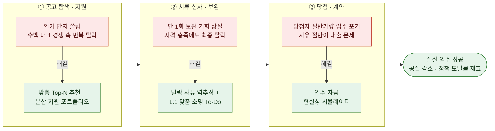
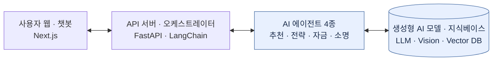
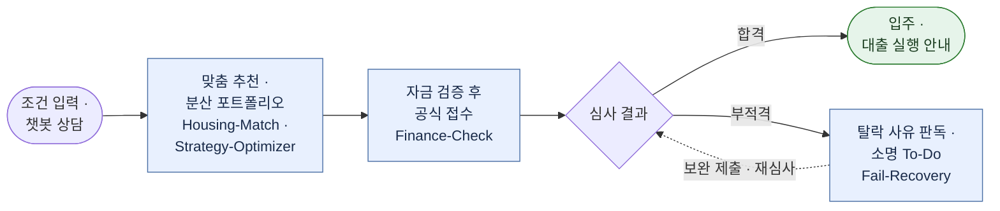

# [붙임 2] 아이디어 기획서

| 팀명 | (미정 / 팀명 입력) |
| :--- | :--- |
| **아이디어명** | **서울 청년 안심하우스 AI** : 공공임대 추천부터 자금 진단·탈락 소명까지 돕는 AI 주거 비서 |
| **해결과제** | 서울시 청년 공공임대 진입 장벽 해소 (쏠림·탈락, 입주 포기, 보완 기회 상실 방지) |

---

## 1. 목적 (문제 인식 및 정책 연계성)

### [핵심 과제] 복잡한 공고 속 '로또 청약' 쏠림

서울시 청년안심주택·행복주택 등은 사업마다 소득·자산·가점 체계가 다르고 공고문도 50~100쪽에 달해, 사회초년생이 유리한 전형을 찾기 어렵습니다. 그 결과 청년들은 인기 역세권 단지로 몰려 수백 대 1의 경쟁 속에서 탈락을 반복하고, 당첨 가능성이 충분한 대안 주택은 외면받습니다.

### [연계 확장] '당첨 후 절반 포기'와 '단 1회의 서류 보완 장벽'

SH에 따르면 2025년 1차 청년안심주택(경쟁률 41.9:1) 당첨자의 절반가량이 입주를 포기하며, 그 사유의 약 절반이 보증금 대출 문제입니다(한국경제, 2025.7.25). 자격을 갖추고도 단 한 번의 서류 보완 기회를 놓쳐 탈락하기도 합니다. 본 서비스는 AI로 세 이탈 지점을 메워 청년의 입주 성공과 서울시의 공실 감소를 돕습니다.

#### [문제 구조도] 청년 공공주거 진입 과정의 3대 이탈 지점과 해결 방안

---

## 2. AI 기술 활용 및 개발 계획

### 2.1 서비스 개요

- **핵심 가치**: 공고·경쟁률 데이터를 AI로 분석해 추천부터 자금 진단·탈락 소명까지 동행
- **주요 기능**:
  1. **맞춤 공고 Top-N 추천**: 소득·자산·직장 위치·예산으로 자격 충족 주택을 1~3순위로 제시
  2. **분산 지원 포트폴리오**: 과거 경쟁률로 당첨 가능성을 추정해 [도전형 + 안정형] 조합 제안
  3. **입주 자금 시뮬레이터**: 버팀목 대출 한도와 필요 현금을 사전 산출해 입주 포기 예방
  4. **탈락 소명 가이드**: 부적격 화면 캡처를 판독해 건보 유형별 소명 To-Do 제공

### 2.2 생성형 AI 활용

#### [시스템 아키텍처]

#### [적용 모델·API·도구]
- **LLM·비전**: Claude Sonnet 5.5 등 멀티모달 LLM (공고 해석·자격 추론·화면 판독)
- **RAG·에이전트**: LangChain + Vector DB(ChromaDB/Qdrant)로 공고 검색·에이전트 운영
- **서비스**: FastAPI(Python) 백엔드 + Next.js 반응형 웹

#### [각 기능에서 AI가 수행할 역할]

| 에이전트 | AI 역할 |
| :--- | :--- |
| **Housing-Match** | 공고 조항 RAG 검색으로 자격 판별, 통근·보증금 선호와 결합해 1~3순위 추천 |
| **Strategy-Optimizer** | 경쟁률·가점 추이로 당첨 가능성 추정, 분산 포트폴리오 리포트 생성 |
| **Finance-Check** | 버팀목 대출 기준과 희망 주택 보증금을 대조해 필요 현금 산출 |
| **Fail-Recovery** | 탈락 캡처를 비전으로 판독해 사유 분류, 건보 유형별 소명 To-Do 작성 |

- **환각 방지**: 모든 안내에 근거 공고·조항을 인용하고, 최종 확인은 관할 기관(SH·LH)으로 안내
- **성능 목표**: 자격 매칭 정확도 95% 이상 · 화면 판독 90% 이상 · 진단 120분→3분 · 응답 5초 이내

### 2.3 활용의 적절성

1. **비정형 공고 해석**: 표·예외 조항이 얽힌 PDF 공고를 RAG로 해석해 개인 조건과 대조
2. **대화형 꼬리질문**: "프리랜서라 건보가 지역가입자예요" 같은 특수 상황을 멀티턴으로 파악
3. **수치와 선호의 종합**: 경쟁률 통계와 주거 선호를 함께 추론해 납득 가능한 전략 설명 생성
4. **멀티모달 판독**: 모호한 탈락 문구가 담긴 캡처를 읽어 구체적 행동 지침으로 변환

### 2.4 아이디어 차별성

| 구분 | LH·SH 청약센터 | 청약홈 | 권리진단 앱 | **본 서비스** |
| :--- | :--- | :--- | :--- | :--- |
| **정보 탐색** | 공고 PDF 게시 | 일정 나열 | 매물 조회 | **AI 챗봇 상담** |
| **지원 전략** | 조건 검색 | 자격 진단 | 없음 | **Top-N + 분산 지원** |
| **자금 진단** | 보증금만 고지 | 계약금 안내 | 없음 | **필요 현금 산출** |
| **탈락 후 지원** | 사유 고지 후 종료 | 없음 | 없음 | **소명 To-Do 제공** |

### 2.5 서비스 흐름도

---

## 3. 기대효과

| 청년 측면: 주거 진입 장벽 해소 | 서울시 측면: 주거 자원 효율화 |
| :--- | :--- |
| **탐색 시간 단축**: 수 시간 걸리던 공고 분석을 3분 대화로 끝내고 맞춤 추천 확인 | **수요 분산**: 특정 단지 과열을 완화하고 소외되던 공공임대로 수요 분산 |
| **현실적 당첨**: 분산 지원 포트폴리오로 반복 탈락과 기회비용 감소 | **공실 감소**: 입주 포기의 주 사유인 대출 문제를 사전 차단해 약 1개월씩 생기던 공실 축소 |
| **포기·탈락 예방**: 자금 진단과 소명 가이드로 입주 포기·서류 탈락 방지 | **민원 경감**: 공고·심사 직후 반복되는 자격·소명 문의를 AI가 먼저 해결 |

---

## 4. 팀 역량

### 4.1 역할 분담

| 성명 | 역할 | 담당 업무 | 보유 역량 |
| :--- | :--- | :--- | :--- |
| **박정훈**(팀장) | 기획·PM | 총괄, 자격 규칙·사용자 플로우 설계, 발표 | 게임 기획자 출신, 1인 게임 개발 완결 |
| **최윤주** | 기획·UX | 소명 프로세스 기획, 챗봇·추천 UI 설계 | 서비스 기획·웹 개발, Figma |
| **김승우** | 개발·AI | 서비스 원안 제안, RAG·챗봇·FastAPI 개발 | 웹 기획·PM, Python·LangChain |
| **박찬종** | 개발·Data | 공고문 라벨링, 당첨 가능성 알고리즘 | 데이터 전공, Vector DB 구축 |

### 4.2 관련 역량
- 팀원 전원이 청년취업사관학교에서 LLM·RAG·풀스택 개발을 익혔고, 모두 공공임대 청약을 겪어 본 실수요자로서 청년 눈높이에서 해결책을 검증합니다.

### 4.3 협업 계획
- **협업 방식**: Discord 데일리 스크럼, GitHub 이슈·PR, Notion·Figma 공유로 기획·개발 병렬 스프린트 진행

| 기간 | 주요 활동 |
| :--- | :--- |
| 10.23 ~ 10.27 | 온라인 OT 참석, 공고문 전처리·라벨링, 시연 기능 우선순위 확정 |
| 10.28 ~ 11.02 | RAG·멀티턴 챗봇, 탈락 캡처 판독·To-Do 개발, 멘토링 피드백 반영 |
| 11.03 ~ 11.07 | 엣지 케이스 QA, 청년 10~15명 베타테스트 후 보완 |
| 11.09 본선 | 3분 라이브 시연: 챗봇 맞춤 추천 → 탈락 캡처 소명 To-Do |
