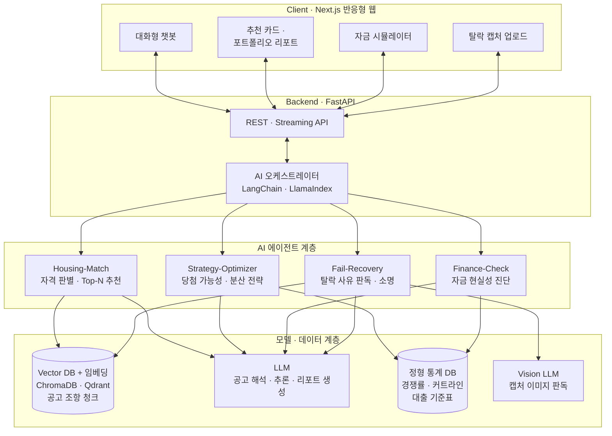
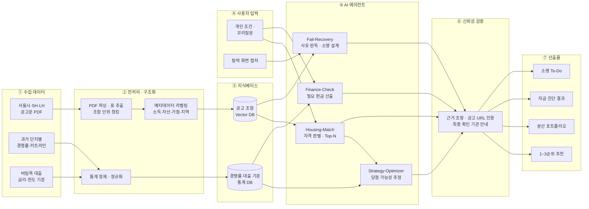
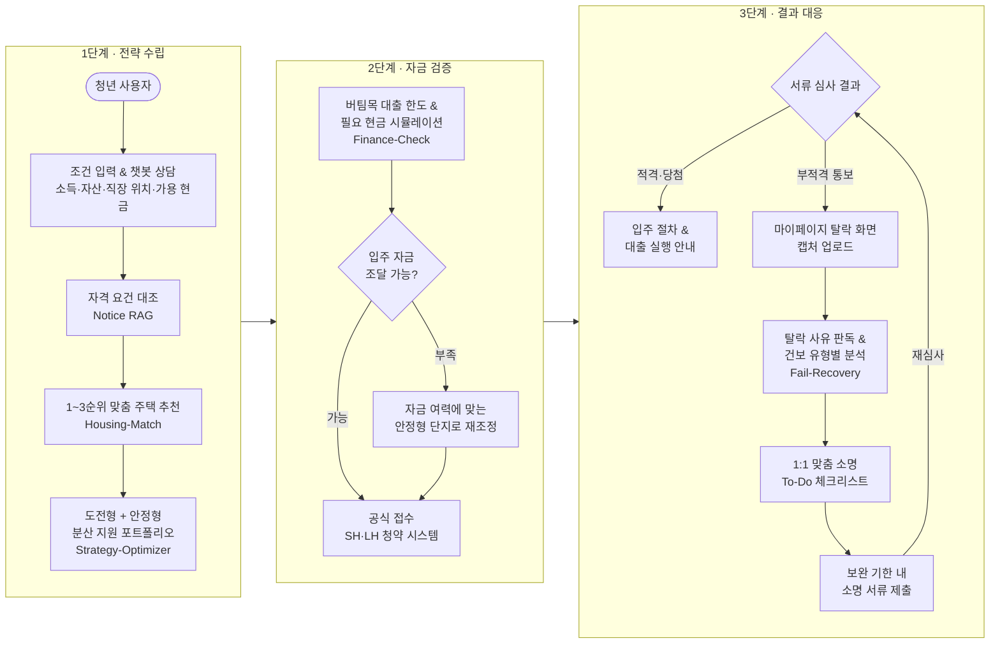

# [붙임 2] 아이디어 기획서

| 팀명 | (미정 / 팀명 입력) |
| :--- | :--- |
| **아이디어명** | **서울 청년 안심하우스 AI (Seoul Youth Home-Agent)** : 공공임대·청년주거 탐색부터 입주 자금 현실성 진단, 탈락 보완·이의신청까지 완결하는 전주기 AI 주거 비서 |
| **해결과제** | 서울시 청년 주거 진입 장벽 해소 및 공공임대·청년월세 신청주의 한계 극복 (정보 비대칭·자금 부족 입주 포기·보완 기회 소실·탈락 방지) |

---

## 1. 목적 (문제 인식 및 정책 연계성)

### [핵심 과제] 복잡한 공공임대의 미로 속 '로또 청약' 쏠림, AI 기반 맞춤 전략으로 해결하다

서울시 청년안심주택, 행복주택 등 청년을 위한 공공주거 정책은 다양하지만, 사업마다 소득·자산·지역 순위·가점 체계가 제각각이고 공고문도 50~100페이지에 달해 사회초년생 개인이 본인에게 가장 유리한 전형을 찾기란 사실상 불가능에 가깝습니다. 그 결과 세부적인 자격 유불리를 파악하지 못한 청년들은 인지도 높은 소수의 역세권 단지로만 맹목적으로 몰려들어 수백 대 일에 달하는 비정상적인 '로또 청약' 경쟁 속에서 탈락을 거듭하고, 조금만 눈을 돌리면 입주 가능성이 충분한 다른 양질의 공공주택들은 선택지에서 소외되는 악순환이 발생하고 있습니다.

본 제안 서비스는 방대한 공고와 주택 데이터를 학습한 AI를 통해 청년의 개인 조건(소득·자산·직장 위치·가용 자금 등)을 정밀 분석하여, 자격 요건을 충족하면서도 선호에 부합하는 최적의 공고와 주택을 우선순위별로 명확히 추천합니다. 나아가 극단적으로 과열된 인기 단지만 무리하게 노리기보다, 과거 경쟁률과 공급 데이터를 바탕으로 **'실질적인 당첨 가능성이 높은 대안 주택 리스트'**를 함께 제시함으로써, 청년이 헛된 기회비용을 줄이고 실제 당첨과 입주로 이어질 수 있는 현실적인 주거 안정을 달성하도록 돕습니다.

### [연계 확장] '당첨 후 절반 포기'와 '단 1회의 서류 보완 장벽', AI로 연결하는 청년 주거 안심망

나아가 서울시 공공주거 현장에서는 치열한 경쟁을 뚫고 당첨되어도 '당첨자의 약 절반(50%)이 대출 불가나 자금 계획 부실로 입주를 포기'하거나, 자격을 갖추었음에도 '단 한 번뿐인 서류 보완 기회를 놓쳐 최종 탈락'하는 또 다른 구조적 역설이 발생하고 있습니다. 이는 흩어져 있는 정보 속에서 실제 입주에 필요한 현금과 대출 한도를 사전에 검증해 주는 장치가 없고, 복잡한 소득·건강보험 소명 절차를 사회초년생 눈높이에서 짚어주는 창구가 없기 때문입니다.

이에 본 서비스는 사전 자금 현실성 시뮬레이션으로 당첨 후 포기 리스크를 선제적으로 예방하고, 탈락 위기에 놓였을 때 비정형 탈락 통보를 AI로 역추적하여 정확한 1:1 맞춤 소명 가이드를 제공합니다. 이를 통해 청년에게는 억울한 탈락을 방지하는 든든한 주거 사다리를 제공하고, 서울시에는 공실 낭비 감소와 주거 정책 도달률 극대화라는 실질적 행정 가치를 완성합니다.

---

## 2. AI 기술 활용 및 개발 계획

### 2.1 서비스 개요

- **핵심 가치**: 
  - 방대한 서울시 공공주택 공고와 과거 청약 데이터를 AI로 학습하여, 복잡한 전형 속에서 청년 개인에게 최적화된 공고를 우선순위별로 추천하고 무리한 쏠림 대신 **'현실적 당첨 가능성 중심의 분산 지원 포트폴리오'**를 설계해 주는 AI 주거 전략 비서입니다.
  - 나아가 신청 전 입주 자금 현실성 진단부터, 탈락 시 단 1회의 보완 기회를 살리는 1:1 맞춤 소명 가이드까지 완결하여 청년의 실질적인 주거 안정을 전주기로 동행합니다.

- **주요 기능**:
  1. **[핵심 기능 1] AI 기반 개인 맞춤형 공고 및 주택 다순위(Top-N) 추천**:
     - 사용자가 기본 정보(소득, 자산, 직장/학교 위치, 가용 예산 등)를 입력하면, AI가 복잡한 서울시 공공임대(청년안심주택, 행복주택, 매입임대 등) 공고문 지식베이스와 대조.
     - 지원 자격 충족 여부를 정밀 분석하고 청년의 주거 선호도(통근 시간, 생활권)에 부합하는 주택을 **1순위, 2순위, 3순위 등 맞춤형 우선순위 리스트**로 한눈에 도출.
  2. **[핵심 기능 2] '현실적 당첨 가능성' 시뮬레이션 및 분산 지원 포트폴리오 제시**:
     - 과거 단지별 공급 경쟁률, 커트라인, 지역 가점 데이터를 바탕으로 각 주택별 실질 당첨 가능성을 예측 분석.
     - 극단적 초고경쟁률의 인기 단지만 무리하게 고집하다 탈락하지 않도록, **[도전형(인기 단지) + 안정형(현실적 당첨권 단지)]으로 조합된 복수 지원 포트폴리오**를 제시하여 실질 입주 성공률을 극대화.
  3. **[연계 기능 1] 입주 자금 현실성 시뮬레이터 (Finance-Check)**:
     - **자금 현실성 진단**: 당첨 후 보증금 마련 실패로 인한 입주 포기를 막기 위해, 청년 버팀목 전세자금대출 한도와 실제 입주에 필요한 자기자본(현금)을 사전에 시뮬레이션하여 입주 완결 가능성을 사전 검증.
  4. **[연계 기능 2] 탈락 사유 역추적 및 1:1 맞춤 소명 가이드 (Fail-Recovery Agent)**:
     - 1차 서류 심사에서 부적격 통보를 받았을 때, 마이페이지의 탈락 화면 캡처(스크린샷)를 업로드하면 AI가 비정형 탈락 사유를 자동 판독.
     - 청년의 건강보험 가입 형태(직장/지역/피부양자)와 연계하여 **"무엇을, 어디서 발급받아, 어떻게 소명해야 하는지"** 맞춤 체크리스트를 제공함으로써 시스템상 단 1회뿐인 보완 기회를 놓치지 않고 실질적 소명 서류를 완비하도록 밀착 지원.

#### [이용자의 사용 흐름]
- **전주기 사용자 여정 (End-to-End User Flow)**:
  1. **[1단계: 진단 및 전략 수립]**: 청년 개인 조건(소득·자산·위치·가용현금) 입력 $\rightarrow$ 자격 요건 대조 $\rightarrow$ **다순위 맞춤 주택 추천 & 현실적 당첨 가능성 기반 분산 지원 포트폴리오 확인**
  2. **[2단계: 자금 검증 및 공식 접수]**: 실제 필요 현금 및 청년 버팀목 대출 한도 사전 확인 $\rightarrow$ 자금 조달 현실성 검증 완료 후 안심 공식 접수
  3. **[3단계: 결과 대응 및 사후 동행]**:
     - **[합격 시]**: 입주 절차 및 전세자금대출 실행 안내
     - **[부적격·탈락 시]**: **탈락 통보 캡처 업로드 $\rightarrow$ AI 비정형 탈락 사유 역추적 $\rightarrow$ 1:1 맞춤 소명 To-Do 체크리스트 제공 $\rightarrow$ 단 1회 보완 기회 내 소명 완비 및 구제 지원**

### 2.2 생성형 AI 활용

#### [시스템 아키텍처]

#### [적용 모델·API·도구]
- **최신 고성능 파운데이션 & 멀티모달 LLM**:
  - **Claude 3.7 Sonnet / GPT-4o**: 100페이지에 달하는 비정형 공고문 RAG 해석, 자격 조건 심층 추론, 복합 탈락 사유 비전 판독 및 정밀 소명 로직 생성
  - **Gemini 1.5 Pro / Flash**: 대용량 공고문 및 과거 경쟁률 통계 데이터의 롱컨텍스트(Long-Context) 일괄 분석 및 초고속 매칭 응답
- **문서 및 이미지 비전 처리 엔진**:
  - **멀티모달 Vision API (GPT-4o / Claude 3.7 Vision)**: 마이페이지 부적격·탈락 화면 캡처 이미지의 비정형 텍스트 및 사유 안내문 정밀 판독
- **AI 오케스트레이션 및 데이터 프레임워크**:
  - **LangChain / LlamaIndex**: 공고문 지식베이스 검색 및 다단계 에이전트(추천-진단-소명) 파이프라인 구축
  - **ChromaDB / Qdrant (Vector DB)**: 서울시 공공주택 공고 조항 및 과거 커트라인 데이터 임베딩 저장소
  - **FastAPI (Python) & Next.js**: 실시간 AI 추론 및 반응형 웹 서비스 인터페이스

#### [각 기능에서 AI가 수행할 역할]

1. **Housing-Match Agent (맞춤 공고 및 다순위 추천)**:
   - **역할**: 수십 쪽에 달하는 복잡한 공고문 조항(소득 70%·100% 기준, 지역 가점표)을 벡터화하여 인덱싱하고, 청년 개인 조건과 정밀 대조하여 지원 자격 충족 여부를 정교하게 판별.
   - **추천**: 단순 나열이 아닌, 개인의 선호(통근 시간, 보증금 한도)와 자격 가점을 결합하여 1순위, 2순위, 3순위 맞춤 주택 리스트 도출.
2. **Strategy-Optimizer Agent (현실적 당첨 가능성 및 분산 지원 전략)**:
   - **역할**: 과거 단지별 실질 경쟁률과 당첨 가점 추이를 분석하여 무리한 초고경쟁률 쏠림을 예측.
   - **분산 포트폴리오 생성**: [도전형(인기 역세권) + 안정형(현실적 당첨권)]의 균형 잡힌 복수 지원 전략을 자연스러운 맞춤 리포트 형태로 생성.
3. **Finance-Check & Fail-Recovery Reasoner (자금 현실성 진단 & 탈락 사유 소명 에이전트)**:
   - **자금 진단 역할**: 청년 버팀목 대출 금리·한도 기준과 희망 주택 보증금을 대조하여, 실제 당첨 후 필요한 현금 자산을 사전에 산출하고 무리한 지원으로 인한 입주 포기 리스크를 최소화.
   - **소명 가이드 역할**: 마이페이지의 탈락 통보 캡처 이미지를 멀티모달 비전으로 판독하여 비정형 탈락 사유(예: "소득 증빙 미비", "건보 서식 오류")를 자동 분류하고, 지원자의 건보 유형(직장/지역/피부양자)에 맞춰 "무엇을, 어디서 발급받아, 어떻게 제출해야 하는지" 1:1 맞춤 To-Do 체크리스트 자동 작성.

#### [AI 모델 정량적 개발 및 성능 목표 (Target KPI)]
- **공고문 RAG 및 자격 조건 매칭 정확도 (Accuracy)**: **95% 이상 달성** (공식 공고문 테스트셋 기반 평가)
- **탈락 화면 멀티모달 비전 판독 정확도**: **90% 이상 확보** (비정형 텍스트 및 사유 키워드 추출)
- **공고 탐색 및 진단 소요 시간 단축**: 1회 평균 120분 $\rightarrow$ **대화형 챗봇 3분 이내 (약 97.5% 시간 단축)**
- **소명 체크리스트 생성 지연 시간 (Latency)**: 이미지 업로드 후 **5초 이내 실시간 응답**

### 2.3 활용의 적절성

#### [해당 문제 해결에 생성형 AI가 필요한 이유]
1. **수백 페이지 비정형 공고문의 지능형 학습·라벨링 및 다차원 자격 조건 분석 (RAG)**:
   - 서울시 공공주택 공고문은 표, 각주, 복잡한 예외 조항(소득 산정 방식, 가구원 제외 기준 등)이 얽힌 비정형 PDF 문서로, 기존의 정적 필터링이나 단순 키워드 검색으로는 개인별 자격 충족 여부를 판별할 수 없습니다.
   - LLM과 지식베이스는 수많은 공고문 데이터를 구조화하여 학습하고 조항별·자격별로 정밀하게 라벨링함으로써, 복잡한 행정 조항의 문맥을 깊이 이해하고 청년 개인의 다차원 조건(소득·자산·거주지·통근 거리)과 대조하여 최적의 선택지를 정교하게 도출해 내는 데 필수적입니다.
2. **청년 친화적 대화형 AI 챗봇 인터페이스를 통한 심층 상담 및 꼬리질문 대응**:
   - 일방적인 결과 화면 제시를 넘어, 청년이 본인의 특수한 상황(예: "현재 프리랜서인데 건보료는 지역으로 잡혀요", "회사 위치가 강남인데 통근 40분 이내로 가능한 곳이 있나요?")에 대해 챗봇과 자유롭게 대화하고 심층적인 꼬리질문을 이어갈 수 있습니다.
   - 생성형 AI는 맥락을 기억하는 멀티턴 대화를 통해 사용자의 숨은 니즈와 애매한 조건을 정교하게 파악하여 1:1 맞춤형 가이드를 제공하는 데 가장 최적화된 도구입니다.
3. **정형 통계 데이터와 비정형 주거 선호도를 결합한 '맞춤형 분산 포트폴리오' 생성**:
   - 단순히 "경쟁률 50:1"이라는 과거 통계 수치만 나열하는 것은 청년의 의사결정을 실질적으로 돕지 못합니다.
   - 생성형 AI는 수치 데이터(과거 커트라인, 경쟁률 추이)와 청년의 정성적 주거 선호를 종합 추론하여, 청년이 납득할 수 있는 친절한 설명과 함께 **[도전형(인기 단지) + 안정형(현실적 당첨권)] 복수 지원 포트폴리오 리포트**를 맞춤형으로 생성해 줍니다.
4. **비정형 마이페이지 탈락 화면 캡처 및 복합 사유의 멀티모달 역추적**:
   - 1차 심사 탈락 사유는 시스템마다 "소득 증빙 미비", "자격 요건 불부합 의심" 등 불친절하고 모호한 텍스트로 고지됩니다.
   - 멀티모달 비전 AI는 스마트폰 캡처 이미지 속 비정형 문구를 즉각 판독하고, 지원자의 고용·건강보험 상태에 맞춰 "무엇을 어디서 발급받아 소명해야 하는지" 구체적인 행동 지침(Action Plan)으로 변환하는 실질적인 대안입니다.

#### [기대효과]
- **청년 측면 (주거 진입 성공률 극대화)**:
  - 100쪽 공고문 분석 시간 대폭 단축 (수시간 소요 $\rightarrow$ 대화형 AI 챗봇을 통한 3분 내 맞춤 진단 완료)
  - 맹목적 인기 단지 쏠림 탈피로 현실적 당첨 확률 제고 및 헛된 기회비용 최소화
  - 철저한 사전 자금 진단으로 당첨 후 포기를 예방하고, 체계적인 소명 가이드를 통해 안타까운 서류 탈락 방지 지원
- **서울시·행정 측면 (공공주택 운영 효율화 및 행정 비용 절감)**:
  - 특정 단지 과열 완화 및 상대적으로 소외되던 양질의 공공임대 주택으로 수요 분산 유도
  - 당첨자의 사전 자금 검증을 통한 당첨 후 입주 포기율(기존 약 50%)을 대폭 경감 유도하여 공실 기간 단축
  - 다산콜센터 및 SH 주거포털로 집중되던 단순 서류 문의·이의신청 민원 폭주 대폭 경감

### 2.4 아이디어 차별성

#### [기존 서비스·정책과의 비교]

| 비교 항목 | LH / SH 공식 청약센터 | 한국부동산원 청약홈 | 주거 권리진단 앱 (집지켜 등) | **본 제안 서비스 (서울 청년 안심하우스 AI)** |
| :--- | :--- | :--- | :--- | :--- |
| **주요 타깃** | 공공임대 일반 지원자 | 일반 민영/공공 분양 청약자 | 전세사기 진단 희망 세입자 | **사회초년생·대학생 등 서울시 청년 공공주거 실수요자** |
| **정보 탐색 및 인터페이스** | 일방향 공고문 PDF 게시 (단순 다운로드 형태) | 캘린더 중심 청약 일정 나열 (신청자 주도 탐색) | 등기부등본 및 건축물대장 수동 주소 입력 조회 | **청년 친화적 대화형 AI 챗봇 (자유로운 꼬리질문 및 맞춤 상담 지원)** |
| **추천 방식 및 지원 전략** | 단순 조건 검색 (추천 및 전략 컨설팅 부재) | 자격 진단기 수준 (전략적 추천 기능 부재) | 추천 기능 없음 (개별 매물 위험성만 진단) | **개인 조건 기반 다순위(Top-N) 추천 + 현실적 당첨 중심 분산 포트폴리오** |
| **지원 시점의 의사결정** | 경쟁률 정보 미제공 (초고경쟁률 쏠림 방치) | 과거 단순 당첨 가점 조회 수준 (분산 전략 부재) | 해당 없음 | **과거 경쟁률·공급 데이터 기반 '실질 당첨권 대안 주택' 제시로 쏠림 완화** |
| **사전 자금 조달 진단** | 단순 보증금 금액만 고지 (개인 대출한도 미반영) | 단순 분양가/계약금 일정만 안내 | 해당 없음 | **청년 버팀목 대출 연계 실제 필요 현금 시뮬레이션 (입주 포기 사전 예방)** |
| **탈락 후 사후 지원** | **단순 부적격 사유 고지 후 종료 (사후 지원 전무)** | **탈락 후 지원 기능 전무** | **해당 없음** | **탈락 통보 캡처 분석 $\rightarrow$ 1:1 맞춤 소명 체크리스트 제공 및 보완 대응 지원** |

#### [독창적인 핵심 차별화 요소]
1. **'일방향 공고문 나열'에서 '대화형 꼬리질문 AI 챗봇'으로의 패러다임 전환**:
   - LH·SH 홈페이지의 100쪽 PDF를 개인이 직접 독해해야 했던 방식을 탈피하여, 사용자가 애매한 고용·소득 조건이나 출퇴근 희망지를 챗봇과 자유롭게 상담하며 즉각적인 맞춤 답변을 얻을 수 있습니다.
2. **무리한 '로또 청약 쏠림'을 깨는 '현실적 당첨 가능성 분산 포트폴리오'**:
   - 기존 청약 플랫폼들이 단지별 인지도와 경쟁률 과열을 그대로 방치했던 것과 달리, 과거 공급 통계를 AI로 분석하여 청년에게 **[도전형(인기 단지) + 안정형(현실적 당첨 단지)]의 최적 조합**을 제시함으로써 실제 당첨과 입주 성공률을 극대화합니다.
3. **신청주의 행정의 사각지대를 메우는 '탈락 후 1:1 맞춤 소명 지원 (Fail-Recovery)' 파이프라인**:
   - 어떤 공공 플랫폼이나 민간 부동산 앱도 다루지 않던 '서류 탈락 후 보완 단계'를 정조준하여, 단 1회의 보완 기회에 무엇을 제출해야 하는지 비정형 화면 캡처로부터 역추적해 주는 국내 유일의 사후 케어 에이전트입니다.

### 2.5 서비스 흐름도

#### [전주기 서비스 흐름도]

#### [전주기 서비스 흐름 요약표]

| 단계 | 사용자 여정 | 담당 AI 컴포넌트 | 핵심 기능 및 산출물 |
| :---: | :--- | :--- | :--- |
| **1단계 (전략 수립)** | **AI 대화 상담 & 맞춤 추천** | • **대화형 AI 챗봇** • **Notice RAG (라벨링 엔진)** • **Strategy-Optimizer** | • 특수 고용·소득 상황 꼬리질문 및 심층 상담 • 서울시 공고 DB 정밀 대조 $\rightarrow$ **1~3순위 맞춤 주택 도출** • 과거 경쟁률 분석 $\rightarrow$ **현실적 당첨 분산 포트폴리오** |
| **2단계 (자금 검증)** | **자금 시뮬레이션 & 안심 공식 접수** | • **Finance-Check (자금 현실성 진단 엔진)** | • 청년 버팀목 전세자금대출 한도 및 실제 필요 현금 사전 산출 • 당첨 후 자금 부족으로 인한 입주 포기 리스크 선제 차단 • **자금 조달 가능 여부 확인 후 자신감 있는 공식 접수** |
| **3단계 (결과·구제)** | **결과 대응 & 단 1회 보완 지원** | • **Fail-Recovery Reasoner** (멀티모달 비전 역추적) | • [합격 시] 입주 절차 및 보증금 실행 안내 • [부적격 시] **탈락 화면 캡처 분석 $\rightarrow$ 1:1 맞춤 소명 To-Do 제공** • **시스템상 단 1회뿐인 보완 기회를 체계적으로 대응하여 구제 지원** |

#### [단계별 상세 처리 프로세스]
1. **[1단계: AI 상담 및 맞춤 전략 수립]**
   - **사용자 입력**: 소득·자산, 직장/학교 위치, 가용 예산 등을 챗봇 인터페이스에 입력하고 자유로운 꼬리질문으로 상담 진행.
   - **AI 분석 및 추천**: `Notice RAG`가 공고문 지식베이스와 대조하여 자격 적합성을 검증하고, `Strategy-Optimizer`가 과거 경쟁률 통계를 결합하여 **[1~3순위 맞춤 주택 + 현실적 당첨권 분산 포트폴리오(도전형+안정형)]**를 제시.
2. **[2단계: 자금 진단 및 공식 접수]**
   - **자금 현실성 확인**: 당첨 후 입주 포기를 막기 위해, `Finance-Check`를 통해 예상 대출 가능액과 실제 필요 현금을 사전 시뮬레이션하여 준비된 상태로 공식 접수 진행.
3. **[3단계: 결과 대응 및 탈락 사유 구제]**
   - **적격 판정 시**: 입주 안내 및 대출 실행 프로세스로 연계.
   - **부적격 통보 시 (핵심 구제 파이프라인)**: 마이페이지 탈락 화면 캡처 업로드 $\rightarrow$ `Fail-Recovery Reasoner`가 비정형 탈락 사유 자동 판독 $\rightarrow$ 지원자의 건보 형태에 맞춘 **1:1 맞춤 소명 To-Do 체크리스트(발급처·옵션·서식)** 제공 $\rightarrow$ 단 1회의 보완 기회 내 서류 완비로 실질적 구제 지원.

---

## 3. 기대효과

본 서비스는 정보 비대칭으로 인해 소수 인기 단지에만 몰려 탈락을 거듭하던 청년들에게 **'나에게 맞는 실질적인 당첨의 길'**을 열어주고, 자금 부족이나 소명 실패로 주거 기회를 잃던 청년들을 선제적으로 보호하는 **전주기 주거 안심망**을 구축합니다.

### [청년 당사자 측면: 주거 진입 장벽 해소 및 실질 당첨률 극대화]
- **맹목적 '로또 청약' 탈피와 현실적 입주 성공**: 수백 대 일에 달하는 인기 역세권 단지만 바라보다 지치던 청년들에게, AI가 분석한 **'현실적 당첨권 분산 포트폴리오(도전형+안정형)'**를 제공하여 실질적인 당첨 및 입주 성공률을 대폭 끌어올립니다.
- **정보 탐색 및 상담 비용 획기적 단축**: 100쪽에 달하는 복잡한 공고문과 씨름할 필요 없이, **대화형 AI 챗봇과의 편안한 대화(3분 이내)**만으로 본인의 특수 상황(프리랜서, 세대분리 등)에 맞는 맞춤형 1~3순위 주택과 지원 전략을 즉시 도출합니다.
- **당첨 후 포기 및 억울한 탈락 최소화**: 접수 전 자금 시뮬레이션을 통해 당첨 후 보증금 부족으로 인한 입주 포기를 예방하고, 만약 탈락하더라도 **시스템상 단 1회뿐인 10일간의 보완 기회 내에 정확한 소명 서류를 완비하도록 1:1 안내**함으로써 안타까운 기회 상실을 체계적으로 방지합니다.

### [서울시 및 행정 측면: 주거 자원 효율화 및 스마트 행정 전달체계 확립]
- **공공임대 수요 분산 및 특정 단지 과열 완화**: 소수의 특정 청년안심주택으로만 과도하게 쏠리던 청약 수요를 양질의 대안 공공주택들로 자연스럽게 분산 유도하여, 서울시 공급 주택 전반의 균형 있는 수혜를 달성합니다.
- **당첨 후 포기 방지 및 장기 공실(1개월 이상) 최소화**: 사전 자금 현실성 진단을 통해 준비되지 않은 무리한 지원을 방지함으로써, 당첨자의 50%가 보증금 부족으로 입주를 포기하고 예비 입주자 재심사까지 공실이 장기화되던 행정적·재정적 자원 낭비를 획기적으로 감축합니다.
- **다산콜센터 및 주거포털 민원 폭주 대폭 경감**: 모집 공고 및 서류 심사 발표 직후 반복되던 단순 자격 문의와 서류 소명 관련 항의 전화를 AI 챗봇과 자동 소명 가이드가 선제 해결하여 공무원의 행정 피로도를 획기적으로 낮춥니다.

---

## 4. 팀 역량

### 4.1 역할 분담

| 성명 | 구분 | 담당 업무 및 세부 수행 역할 | 보유 역량 및 배경 |
| :--- | :--- | :--- | :--- |
| **박정훈** | **기획 / PM** (팀장) | • **프로젝트 총괄(PM) 및 시스템 기획 총괄** • 팀원 아이디어(승우·윤주 안) 통합 조율 및 서비스 구체화 • 복잡한 공공임대 전형 및 자격 규칙 체계화 • 전주기 사용자 플로우 설계 및 본선 발표 총괄 | • **게임 기획자 출신 및 1인 게임 개발 완결 경험** • 복잡한 규칙/시스템 설계 및 풀사이클 개발 감각 보유 • 프로젝트 리스크 관리 및 추진 일정 조율 역량 |
| **최윤주** | **기획 / UX** | • **탈락 화면 판독 및 사후 케어 프로세스 기획(아이디어 기여)** • 대화형 챗봇 및 반응형 UI/UX 화면 설계 • 다순위 추천 카드 및 자금 시뮬레이션 화면 프로토타이핑 • 프론트엔드 퍼블리싱 협업 | • **서비스 기획 및 웹 개발 경험 보유** • 직관적인 사용자 여정 및 사후 케어 UX 설계 능력 • Figma 프로토타이핑 및 웹 구현 역량 |
| **김승우** | **개발 / AI·Web** | • **핵심 주거 비서 서비스 원안 발의(메인 아이디어 제안)** • 생성형 AI 에이전트(Notice RAG, 챗봇) 파이프라인 구축 • 멀티턴 대화 및 꼬리질문 상담 로직 엔지니어링 • FastAPI 백엔드 API 개발 및 전체 시스템 연동 | • **웹 기획 및 PM 경험 + 웹 개발 완결 경험** • 서비스 기획 의도를 기술로 직결시키는 풀스택 역량 • Python, LangChain, API 연동 및 백엔드 개발 |
| **박찬종** | **개발 / Data** | • **공공주택 데이터 전처리 및 경쟁률 분석 모델링** • 서울시 공공임대 공고문 데이터 구조화 및 라벨링 • 과거 단지별 청약 경쟁률·가점 통계 분석 • '현실적 당첨 가능성' 산출 알고리즘 구현 | • **데이터 전공 및 데이터 엔지니어링 전문 기술 보유** • 대용량 정형/비정형 공공 데이터 가공 및 분석 역량 • Vector DB 인덱싱 및 통계 데이터 파이프라인 구축 |

### 4.2 관련 역량

- **청년취업사관학교(SeSAC) 기반의 실무 AI 및 풀스택 기술 역량**:
  - 팀원 전원이 2026 청년취업사관학교 실무 집중 과정에 참여 중인 인재들로 구성되어, 최신 생성형 AI 모델(Claude 3.7, GPT-4o, Gemini 1.5) 연동, LangChain 기반 Multi-Agent 설계, RAG 및 Vector DB 인덱싱, 풀스택 웹 프로토타이핑 기술을 탄탄하게 완비하고 있습니다.

- **기획부터 개발·배포까지의 '풀사이클(Full-Cycle) 프로젝트 완결' 경험**:
  - **1인 게임 개발 및 런칭 경험 (정훈)**: 복잡한 규칙 기반 룰셋 기획과 프론트/백엔드를 아우르는 1인 완결형 개발 경험을 보유하여, 공공임대의 복잡한 자격 조건과 예외 조항을 빈틈없는 시스템 로직으로 체계화할 수 있습니다.
  - **기획과 개발의 크로스오버 역량 (윤주, 승우)**: 기획자로서의 사용자 경험(UX) 분석력과 웹 개발자로서의 구현 능력을 동시에 보유하여, 기획 단계의 아이디어를 기술적 병목 없이 즉각 반응형 웹 프로토타입으로 시각화하고 구현할 수 있습니다.
  - **데이터 전공 기반의 전문 데이터 엔지니어링 역량 (찬종)**: 비정형 공공임대 공고문 데이터의 전처리·구조화·라벨링은 물론, 과거 대규모 청약 경쟁률 통계 데이터를 분석하여 신뢰성 높은 '현실적 당첨 가능성 알고리즘'을 안정적으로 구현해 냅니다.

- **실제 청년 세대의 페인포인트 체감에 기반한 문제 해결력**:
  - 팀원 모두가 공공임대 청약 및 청년월세 신청의 정보 비대칭, 100쪽 공고문 해석의 난해함, 서류 미비로 인한 탈락 위기를 직접 겪어본 실수요자 당사자로서, 청년 눈높이에 가장 적합한 실질적 해결책을 도출하고 검증할 수 있습니다.

### 4.3 협업 계획

#### [팀 내 협업 방식 및 일정 관리]
- **소통 및 협업 툴 체계화**: 
  - **Discord / Slack**: 실시간 비동기 소통 및 매일 15분 '데일리 스크럼(Daily Scrum)'을 통해 개발/기획 진행 상황과 병목 이슈를 매일 아침 즉시 공유·해결.
  - **GitHub & Cursor**: 이슈/PR 기반 브랜치 전략(Git-flow) 운영 및 AI 페어 프로그래밍을 통한 빠른 모듈화 개발.
  - **Notion & Figma**: 기획 정책서·RAG 라벨링 데이터셋 관리 및 실시간 UI/UX 프로토타이핑 협업.
- **마일스톤 기반 일정 관리**:
  - 기획(정훈·윤주)과 개발(승우·찬종)이 병렬로 진행되도록 주차별 스프린트를 수립하고, 기능 단위 프로토타입을 지속적으로 통합·검증.

#### [OT·멘토링 참여 계획 및 본선 로드맵]
- **[1단계] 기획서 제출 및 접수 마감 (~10.20)**:
  - 본선 진출을 위한 기획서 최종 점검 및 A4 3쪽 규격 준수 제출 완료.
- **[2단계] 본선 진출 시 집중 개발 및 실증 검증 (10.23 ~ 11.7)**:
  - **1차 (10.23 ~ 10.27) - 기획 구체화 & 공고문 데이터 라벨링**:
    - 온라인 OT 참석 및 세부 심사 기준 확인.
    - 서울시 청년안심주택·행복주택 공고문 데이터 전처리, 자격 요건 및 가점 조항별 메타데이터 태깅/라벨링 작업 완료.
    - 4시간 해커톤 환경에 맞춘 핵심 시연 기능(1순위: 챗봇 맞춤 다순위 추천, 2순위: 탈락 통보 캡처 소명) 우선순위 확정.
  - **2차 (10.28 ~ 11.02) - MVP 코어 개발 및 전문가 멘토링**:
    - LangChain 기반 공고문 RAG 검색 파이프라인 및 멀티턴 챗봇 로직 구현.
    - 멀티모달 비전 OCR 기반 마이페이지 탈락 화면 캡처 판독 및 To-Do 생성 로직 연동.
    - 기획/개발 멘토링 집중 참여: 공공임대 행정 프로세스 적합성 검토 및 LLM 비전 판독 속도/정확도 경량화 피드백 반영.
  - **3차 (11.03 ~ 11.07) - QA, 실사용자 베타테스트 및 최종 빌드 안정화**:
    - 팀 내 기능 단위 통합 테스트(QA) 및 엣지 케이스(특수 건보 자격, 애매한 소득 분위) 예외 처리 로직 점검.
    - 공공임대 준비 청년 지인 및 실제 커뮤니티(청년 주거 오픈채팅방 등) 타깃 **실사용자 소규모 베타테스트(10~15명)** 진행.
    - "추천 결과가 납득 가능한가?", "소명 체크리스트가 명확한가?" 등 사용자 피드백을 수렴하여 UI/UX 문구 및 추천 알고리즘 가중치 최종 보완.
- **[3단계] 본선 경연 및 최종 라이브 시연 (11.9, DDP 컨퍼런스홀)**:
  - 현장 4시간 내 안정화된 최종 빌드 배포 및 네트워크 환경 세팅.
  - **핵심 3분 집중 라이브 시연**: 
    1. 대화형 AI 챗봇과의 꼬리질문 상담을 통한 **'개인 맞춤 다순위 추천 & 현실적 당첨 분산 포트폴리오'** 즉시 도출.
    2. 실제 부적격 통보 화면 캡처 업로드 $\rightarrow$ **'단 1회 보완 기회를 살리는 1:1 맞춤 소명 To-Do 체크리스트'** 실시간 역추적 시연 및 심사위원 Q&A 대응.
