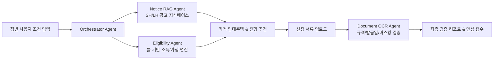

# [붙임 2] 아이디어 기획서

| 팀명 | (미정 / 팀명 입력) |
| :--- | :--- |
| **아이디어명** | 서울 청년 안심하우스 AI (Seoul Youth Home-Agent) : 청년 맞춤형 공공임대주택 핀포인트 추천 및 신청 서류 결격 사전 검증 에이전트 |
| **해결과제** | 서울시 청년 주거 진입 장벽 해소 및 공공임대주택 신청주의 한계 극복 (서류 탈락·정보 비대칭 해소) |

---

## 1. 목적 (문제 인식 및 정책 연계성)

### 1.1 주제 선정 배경 및 필요성
- **청년층의 극심한 주거 불안 및 공공임대 수요 집중**:
  - 최근 전세사기 여파 및 고금리·고물가로 인해 2030 청년층의 주거비 부담이 급증하면서 SH·LH의 청년 안심주택 및 행복주택에 대한 청년층의 관심과 지원 수요가 역대 최고 수준에 달하고 있음.
  - 그러나 실제 공급되는 공공임대주택 유형(청년안심주택, 역세권 청년주택, 행복주택, 청년 매입임대, 공공지원 민간임대 등)이 다변화되어 있고 주체(SH, LH, 서울시)마다 정보가 분절되어 있어 정보 접근성이 매우 취약함.
- **방대한 모집공고문(PDF)과 높은 정보 탐색 비용**:
  - 1회 공고당 50~100페이지에 달하는 복잡한 모집공고문 내에서 본인에게 해당하는 소득 분위(가구원수별 도시근로자 월평균소득 70%·100%·120%), 자산 가액, 차량 소유 기준, 지역 순위 및 가점 요건을 개인이 직접 해석해야 하는 극심한 병목이 존재함.
- **신청 단계의 서류 미비 및 사소한 실수로 인한 탈락률 빈발**:
  - 공공임대 청약 접수 시 주민등록등본, 초본, 가족관계증명서(상세), 건강보험자격득실확인서 등 다수의 공문서 제출이 요구됨.
  - 공고일 이후 발급 여부 미확인, 주민등록번호 뒷자리 마스킹 누락, 세대주/세대원 구분 오기입 등 사소한 규격 미달로 인해 **자격 요건을 갖추었음에도 서류 미비로 부적격 탈락**하는 사례가 지속적으로 발생하고 있음.

### 1.2 문제의 근본 원인 분석
1. **공공 정보의 파편화와 신청주의 한계**:
   - 각 기관 누리집(SH, LH, 서울주거포털)에 산발적으로 공고가 게시되며, 시민이 직접 찾아보고 이해해야만 혜택을 받는 '수동적 신청주의' 구조.
2. **청년 친화적 해석 레이어(UX)의 부재**:
   - 전문적인 행정·법률 용어로 작성된 공고문을 청년 사회초년생의 눈높이로 쉽게 풀어주는 가이드 장치가 없음.
3. **제출 전 피드백 창구의 부재**:
   - 공공기관은 인력 한계로 인해 접수 마감 전 개별 신청자의 서류 적격 여부를 사전 검토해줄 수 없어, 마감 후 심사 단계에서 대규모 부적격 처리가 발생함.

### 1.3 해결 과제 및 서울시 정책 연계성
- **해결 과제**:
  1. 복잡한 공공임대 공고문을 단일 파이프라인으로 구조화하여 청년 개인 조건에 최적화된 **'단 1개의 맞춤형 주택/전형 핀포인트 추천'**.
  2. 제출 전 서류를 사전 분석하여 누락 및 부적격 요소를 원천 차단하는 **'서류 사전 검증(DocuCheck)'**.
- **서울시 기존 정책과의 연계**:
  - **서울시 청년안심주택(역세권 중심 청년 임대주택 공급 정책)**: 공급된 주택의 공실 방지 및 실수요 청년층 매칭률 제고.
  - **SH 서울주택도시공사 청년 매입임대 사업**: 복잡한 공급 순위(1·2·3순위) 해석 및 청년층 신청 편의 제공.
  - **서울시 청년월세지원**: 공공임대 탈락자 또는 진입 준비 청년을 위한 단계별 주거 복지 연계 지원.
  - *신규 제도를 신설하지 않고, 서울시가 이미 막대한 예산을 투입 중인 핵심 주거 사업의 최종 신청 단계 병목을 해소.*

---

## 2. AI 기술 활용 및 개발 계획

### 2.1 서비스 개요 및 주요 기능
- **핵심 가치**: "공고 탐색부터 서류 제출까지, 청년의 시간 낭비와 서류 탈락을 제로(Zero)화하는 주거 비서"
- **주요 기능 구성**:
  1. **맞춤형 공공임대 핀포인트 추천 에이전트**:
     - 사용자 조건(소득, 자산, 거주지, 희망 자치구, 예산 등)을 일상 언어로 입력받아, 현재 모집 중인 SH/LH 공고 중 당첨 확률과 적합도가 가장 높은 최적의 단지·전형·평형을 추천.
  2. **복합 자격 및 가점 시뮬레이터 (Rule-based + LLM)**:
     - 가구원 수별 소득 분위 및 자산 충족 여부를 정밀 계산하고, 청약통장 납입 횟수, 서울 거주 기간 등을 대조해 실시간 예상 가점 산출.
  3. **AI 주거 서류 사전 점검기 (DocuCheck)**:
     - 등본, 가족관계증명서, 소득금액증명원 등 PDF/이미지 업로드 시 Vision OCR로 발급일자(공고일 이후 여부), 마스킹 처리, 세대주 관계를 대조해 보완 필요 사항 즉각 브리핑.
  4. **청약 타임라인 알리미 & 체크리스트**:
     - 서류 접수, 심사 대상자 발표, 계약 체결일까지 단계별 필수 To-Do 리스트 및 일정 알림 제공.
- **사용자 여정 (User Flow)**:
  - `조건 입력` (예산/지역/상황) $\rightarrow$ `최적 공고 매칭` (단지·전형 단일 추천) $\rightarrow$ `필요 서류 안내` $\rightarrow$ `서류 파일 업로드` $\rightarrow$ `AI 결격 사유 검증 및 수정 가이드` $\rightarrow$ `안심 접수 완료`.

### 2.2 생성형 AI 파이프라인 및 개발 기술 스택
- **적용 모델 및 도구**:
  - **Foundation Model**: Claude 3.5 Sonnet / GPT-4o (비정형 공고문 RAG 및 문서 구조화), GPT-4o-mini (경량 질의응답)
  - **Vision & OCR**: 멀티모달 Vision API 및 Document Parser (공문서 서식 판독)
  - **프레임워크 및 DB**: LangChain / LlamaIndex, ChromaDB / FAISS (Vector Store), Fast API, React / Next.js
- **AI 컴포넌트별 상세 역할**:
  - **Orchestrator Agent**: 사용자 질의 의도 파악, 조건 분석 및 하위 전문 에이전트 작업 라우팅.
  - **Notice RAG Agent**: SH/LH 공고문 전문(PDF/HWP)을 청크 단위로 임베딩하여 조건에 맞는 조항과 평형별 공급 호수 검색.
  - **Eligibility Agent**: RAG 검색 결과와 사용자의 소득·자산 정보를 룰 엔진(Rule Engine)과 결합하여 정확한 가점/순위 산정.
  - **Document OCR Agent**: 업로드된 행정 문서의 비식별화(개인정보 보호) 및 필수 유효 항목 자동 검증.

### 2.3 생성형 AI 도입의 적절성 및 신뢰성 확보 방안
- **생성형 AI가 반드시 필요한 이유**:
  - 수십 페이지의 비정형 문서(공고문)는 정형화된 DB 구축에 막대한 리소스가 소요되나, LLM 기반 RAG는 최신 공고 PDF를 즉시 인덱싱하여 서비스에 반영 가능.
  - 사용자의 복잡한 자연어 질문(예: "현재 프리랜서고 부모님과 따로 사는데 월세 30 이하로 들어갈 수 있는 곳 있어?")을 다각도로 추론하여 적절한 전형으로 매핑할 수 있음.
- **환각(Hallucination) 방지 및 안전장치**:
  - **Grounding & Source Citation**: 모든 추천 및 자격 판단 결과 하단에 근거가 되는 **공고문 명칭, 해당 페이지 번호, 원문 조항**을 명시.
  - **Hybrid Architecture (Rule Engine + LLM)**: 소득 분위 및 자산 가액 등 수치 기반 자격 판정은 오차 없는 결정론적 룰 엔진(Rule Engine)으로 수행하고, 해설 및 인터페이스에 LLM 활용.
  - **보안 및 개인정보 보호**: 서류 판독 시 주민등록번호 등 민감 식별자는 클라이언트단 및 파이프라인 진입 즉시 마스킹 처리하여 저장하지 않음.

### 2.4 기존 서비스와의 차별성
| 비교 항목 | 기존 부동산/청약 앱 (호갱노노, 청약홈 등) | 전세사기 권리분석 앱 (집지켜 등) | **본 제안 서비스 (서울 청년 안심하우스 AI)** |
| :--- | :--- | :--- | :--- |
| **주요 타깃** | 일반 민영/공공 분양 아파트 청약자 | 전세사기 위험 진단 희망 세입자 | **사회초년생·대학생 등 청년 공공임대 실수요자** |
| **정보 탐색** | 지도/단지 중심의 단순 나열 | 등기부등본 및 시세 분석 중심 | **개인 조건·가점 기반 1:1 맞춤형 최적 전형 핀포인트 추천** |
| **서류 검증** | 단순 필요 서류 텍스트 목록 나열 | 서류 검증 기능 부재 | **제출 서류 파일 업로드 시 사전 결격·누락 자동 검증** |
| **서울시 밀착성** | 전국 단위 일반 통계 | 사후 권리관계 중심 | **서울시 청년안심주택·청년월세 등 시정 인프라 직접 연계** |

### 2.5 서비스 흐름도 및 시스템 구성도 (시각자료)

---

## 3. 기대효과

### 3.1 청년 당사자 측면 (주거 안정 및 시간 절감)
- **정보 탐색 시간 획기적 단축**: 평균 3~4시간 이상 소요되던 복잡한 공고문 분석 시간을 **5분 이내**로 단축.
- **서류 미비로 인한 부적격 탈락 제로화**: 공문서 유효기간 및 기재 항목 사전 점검을 통해 억울한 탈락 방지 및 청년의 행정 효능감 증진.
- **주거비 부담 완화**: 자격에 맞는 최적의 공공임대주택 입주 기회를 선제적으로 포착하여 주거 빈곤 탈출 지원.

### 3.2 서울시 정책 및 행정 측면 (행정 효율화 및 전달체계 혁신)
- **공공기관 접수·심사 행정 비용 대폭 절감**: SH 등 접수 기관의 서류 미비자 확인 및 보완 요청 민원 업무를 대폭 경감.
- **청년 주거 정책 도달률(Coverage) 극대화**: 청년안심주택 등 서울시 주요 주거 인프라의 미달 및 공실 방지, 실수요자 타깃 도달률 향상.
- **데이터 기반 주거 수요 분석**: 청년층이 선호하는 지역·평형·예산 데이터 통계를 익명 집계하여 향후 서울시 청년 주택 공급 정책 수립의 기초 자료로 환류.

### 3.3 사회적·경제적 파급효과 (주거 사다리 복원)
- **사회초년생의 안정적 자립 기반 마련**: 주거비 지출 감소로 청년층의 자산 형성 및 경제적 자립 사다리 복원.
- **공공 행정의 디지털 포용성 강화**: 복잡한 행정 서류와 신청 절차로 인한 디지털 격차를 해소하고 청년 친화적인 스마트 복지 모델 제시.

---

## 4. 팀 역량

### 4.1 팀원별 역할 분담
| 성명 | 구분 | 담당 업무 및 세부 수행 역할 | 보유 역량 / 기술 스택 |
| :---: | :---: | :--- | :--- |
| **박정훈** | 기획 / PM | • 프로젝트 총괄 및 일정 관리 • 서울시 청년 주거 정책 분석 및 기획서 작성 • 본선 PT 발표 및 데모 시나리오 설계 | • 정책 분석 및 서비스 기획 • 프로젝트 매니지먼트 (PM) • IR Deck 및 기획서 작성 역량 |
| **최윤주** | 기획 / UX | • 사용자 여정(User Flow) 및 화면 와이어프레임 설계 • 프론트엔드 UI/UX 디자인 • 서류 검증 결과 리포트 인터페이스 기획 | • 서비스 기획 및 UX/UI 설계 • Figma, 화면 프로토타이핑 • 디자인 가이드라인 수립 |
| **김승우** | 개발 / AI | • SH/LH 공고문 파싱 및 Vector DB(RAG) 구축 • Multi-Agent 프롬프트 엔지니어링 및 LangChain 파이프라인 • 조건 매칭 및 추천 알고리즘 구현 | • Python, LangChain, LlamaIndex • Vector DB (Chroma, FAISS) • LLM API 연동 및 RAG 최적화 |
| **박찬종** | 개발 / Full-Stack | • 공문서 OCR/Vision 검증 파이프라인 연동 • Fast API 백엔드 서버 구축 및 RESTful API 설계 • React/Next.js 웹 프로토타입 구현 및 배포 | • Python Fast API, Node.js • React, Next.js, Tailwind CSS • Vision OCR 연동 및 웹 통합 배포 |

### 4.2 보유 역량 및 프로젝트 수행 경험
- **교육 이수 및 도메인 역량**:
  - 2026 청년취업사관학교(SeSAC) AI/SW 실무 집중 과정 참여 인재로 구성되어 생성형 AI API 연동 및 풀스택 개발 역량 보유.
  - 최신 LLM(Claude, GPT-4o) 및 RAG 프레임워크 기반의 실무 프로젝트 수행 경험 보유.
- **활용 가능 기술 및 도구**:
  - Frontend/Backend: React, Next.js, FastAPI, Python
  - AI & Data: LangChain, LlamaIndex, OpenAI/Anthropic API, Tesseract/Cloud Vision OCR, ChromaDB
  - Collaboration: GitHub, Figma, Notion, Discord

### 4.3 본선 대비 개발 로드맵 및 협업 계획
- **협업 방식**:
  - GitHub 기반 형상 관리 및 기능별 브랜치 전략, Discord/Slack을 통한 일일 스크럼(Daily Standup), AI 바이브코딩 도구(Cursor 등)를 활용한 초고속 프로토타이핑.
- **단계별 추진 로드맵**:
  - **서류 접수 마감 (~10.20)**: 기획서 최종 점검 및 제출 (A4 3쪽 규격 완비)
  - **본선 준비 및 멘토링 (10.23 ~ 11.7)**: 
    - 온라인 OT 참석
    - 기획 멘토링(2회): 공고문 수집 범위 및 사용자 시나리오 정교화
    - 개발 멘토링(2회): RAG 검색 정확도 튜닝 및 서류 Vision OCR 경량화 파이프라인 검증
    - 4시간 현장 구현을 위한 사전 베이스라인 코드 및 핵심 데모 1개(추천 + 서류 검증) 완성
  - **본선 경연 (11.9, DDP)**: 현장 프로토타입 최종 완성, 2분 압축 시연 및 심사위원 질의응답 대응
